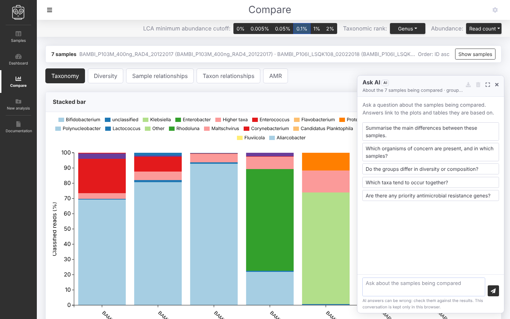

.. _ai:

AI features
===========

The MARTi GUI has two optional features that use a large language model (LLM), such as Claude, ChatGPT or a model
running on your own computer:

* **Narrative analysis** - a short written summary of a sample's results on its Dashboard.
* **Ask AI** - a chat panel on the Samples, Compare and Dashboard pages that answers questions about the samples on the
  page, links to the plots its answers are based on, and can select samples or open views for you.

Both work the same way: the GUI server runs MARTi's own analyses on the sample data (the same calculations the plots
use) and gives the model their results. The model writes the text; it does not see the raw data or calculate the
numbers itself. Nothing is sent to a model unless someone clicks *Generate narrative analysis* or asks a question.

Everything runs in the GUI. The MARTi Engine never contacts a model, so it can run on a cluster without internet
access.

AI-written text can be wrong. The narrative card shows automatic checks of every organism, gene and number it
mentions, and chat answers link to the results they are based on, but always check important findings against the
plots and tables.

You can also use MARTi's results with an AI assistant such as the Claude app, outside the GUI. See :ref:`mcp`.

.. _aisetup:

Setting up the AI features
--------------------------

**1. Python.** The AI features run a small Python program, ``marti_llm``, that comes with MARTi in the ``marti-llm``
folder. They need Python 3.10 or later with the packages in ``marti-llm/requirements.txt``::

    pip install -r /path/to/MARTi/marti-llm/requirements.txt

``numpy`` and ``httpx`` are needed for the GUI's features; ``mcp`` and ``pyjwt`` are only needed for the
:ref:`MCP server <mcp>`. The GUI runs ``python3`` and finds the ``marti-llm`` folder beside its own ``gui`` folder.
If you use a different Python (for example in a conda environment), or keep ``marti-llm`` elsewhere, start the GUI
with ``--llm-python`` and ``--llm-tools``, or set ``LLMPython`` and ``LLMToolsDir`` in ``marti_engine_options.txt``.

**2. A model.** Open *Options* (the cog icon, top right) and fill in the *AI model* section:

* *Provider* - Anthropic (Claude), OpenAI, or a local or other OpenAI-compatible server, such as LM Studio
  (``http://localhost:1234/v1``) or Ollama (``http://localhost:11434/v1``).
* *Model* - the model's name, as the provider lists it.
* *API key* - from your provider account. Most local servers do not need one.

Click *Test connection* to save the settings and check that the model can be reached, or *Save* to save them without
testing. A Claude.ai or ChatGPT subscription does not include API access: cloud providers need an API key from their
developer platform, which is billed separately.

Which model to choose:

* The narrative works with any capable model.
* *Ask AI* needs a model that can call tools (functions). Current Claude and OpenAI models can, as can many local
  models (for example Gemma, Llama, Mistral or Qwen models served by LM Studio or Ollama). Answers can take several
  analysis steps, so local models may be slow, and smaller models can be unreliable at choosing and calling tools.
  Give local models a context length of at least 16k tokens.

**Where the settings are kept.** The settings are stored on the computer running the GUI, in
``~/.marti/llm_settings.json`` (readable only by the account running the GUI), not in the browser, so they apply to
everyone using that GUI. The API key is never sent back to a browser; *Options* only shows its last four characters.
A key in the ``MARTI_LLM_API_KEY`` environment variable takes precedence over the saved one.

**Settings in marti_engine_options.txt:**

* ``LLMPython`` - the Python to run (default ``python3``).
* ``LLMToolsDir`` - folder containing the ``marti_llm`` package (default: MARTi's own ``marti-llm`` folder).
* ``LLMSettingsFile`` - where the model settings are stored (default ``~/.marti/llm_settings.json``).
* ``LLMTimeoutMinutes`` - how long one narrative or chat answer may take before it is stopped (default 10).
* ``LLMChatInRestrictedMode`` - ``true`` to offer the chat in :ref:`restricted mode <restrictedmode>` (default ``false``).

**What is sent to the provider.** With a cloud provider, each narrative sends a summary of the sample's results (its
top taxa, screening results, resistance genes, diversity and read statistics, plus its name and metadata), and each chat
question sends the conversation and the analysis results the model asks for. With a local server, everything stays on
your own computers. Check that this fits your data's confidentiality requirements before choosing a cloud provider.

.. _narrative-analysis:

Narrative analysis
------------------

The Dashboard has a *Narrative analysis* card: a short written summary of the sample's results (organisms of note,
antimicrobial resistance and data quality), with *Show full analysis* for the detailed sections. Narratives are only
ever generated when someone clicks *Generate narrative analysis* (or *Regenerate*).

How it works:

* The GUI runs a fixed set of analyses on the sample: its top taxa, screens against curated lists of organisms (for
  example human pathogens, food spoilage organisms or plant pathogens, depending on the sample type), priority
  resistance genes, diversity and sequencing saturation. It sends their results to the model in one request.
* The answer is checked against those results: any organism, resistance gene or number in the text that does not match
  them is listed under *Automatic checks* on the card.
* The narrative is saved as ``narrative.json`` in the sample's folder, next to ``sample.json``, so it moves with the
  sample's data and every user sees the same narrative. The GUI needs write access to that folder.
* If more reads have been analysed since the narrative was written, the card says so, and it can be regenerated.

**Sample types.** What the narrative concentrates on depends on the sample type, which is chosen from the sample's
metadata keywords (see :ref:`samplemetadata`). The profiles are checked in this order, and the first that matches is
used:

.. list-table::
   :header-rows: 1
   :widths: 25 75

   * - Profile
     - Chosen by keywords such as
   * - Food manufacturing environment
     - food, factory, manufacturing, processing, dairy, meat, abattoir, kitchen, production, drain, surface, hygiene,
       ingredient, product
   * - Outdoor air
     - air, airborne, aerosol, bioaerosol, pollen, spore trap, aerobiology, atmosphere, outdoor (but not with indoor)
   * - Clinical
     - clinical, patient, hospital, blood, urine, sputum, wound, stool, faecal, nasal, throat, infant, gut, airway
   * - Environmental
     - water, river, lake, wastewater, sewage, soil, marine, freshwater, environment, sediment
   * - General
     - any other sample

The organism lists used for screening are illustrative starter lists in ``marti-llm/marti_llm/reference_lists``;
review them for your own work.

**Writing narratives without an API key.** If you use the Claude app (or another MCP client) with MARTi's MCP server,
you can ask it to write the narrative analysis for a sample. It uses the same inputs and checks and saves
``narrative.json``, and the Dashboard shows it within a few seconds. See :ref:`mcp`.

.. _askai:

Ask AI
------

The *Ask AI* button (bottom right of the Samples, Compare and Dashboard pages) opens a chat panel. Ask a question about
the samples on the page, for example:

* On the Dashboard: "Are there any human pathogens in this sample?" or "Was it sequenced deeply enough?"
* On the Compare page: "Do the groups differ in diversity?", "Which organisms of concern are present, and in which
  samples?" or "Which taxa tend to occur together?"

The model answers by running MARTi's analyses on the server (diversity, group comparisons, pathogen and
resistance-gene screens, co-occurrence and so on). It can only see the samples open on the page. On the Compare page it
is told the groups set in the :ref:`Samples card <comparesamplescard>`, and the rank and LCA cutoff you are viewing.
The panel shows each analysis as it runs; *Stop* cancels a question.

**Links.** Answers link to the plots and tables they are based on. Clicking a link opens the right tab and scrolls to
the plot, while the panel stays open; a link to a sample opens its Dashboard. The model can only link to places in the
GUI; any other link is shown as plain text.

**Opening views.** You can also ask the panel to take you somewhere, for example "Open the treemap for
Brancaster1_24-Jul" or "Show me the PCoA". Sample names can be given in full, as run/name, or by any part of the name
that only one sample has; if a name matches several samples, the model asks which you mean.

**Conversations** are kept in your browser only, one for each page and set of samples: reopening the same comparison
or sample brings its conversation back, and other people using the GUI do not see it. The GUI server does not store
conversations. Use the download button to save a conversation as a Markdown file, and the bin button to clear it.

.. _askaisamples:

Finding and selecting samples
^^^^^^^^^^^^^^^^^^^^^^^^^^^^^

On the Samples page, Ask AI finds and selects samples, for example:

* "Select the samples collected in summer 2025"
* "Also select samples within 5 miles of Norwich city centre"
* "Which samples contain Streptomyces?"
* "List the samples with E. coli"

A search tool on the GUI server does the matching, so the model only turns your request into a search, and says how
it read it (for example, summer 2025 as 1 June to 31 August 2025).

* "Select ..." ticks the matching rows in the table, replacing the current selection unless you say "also" (to add)
  or "deselect" (to remove). The answer has *Undo* and *Compare* buttons.
* "List ..." and "which ..." questions answer with links to each sample and leave the selection alone.
* Organism searches count a sample if it has at least one read for the organism at its lowest non-zero LCA cutoff
  (normally 0.005%), unless you ask for a threshold, for example "at least 1% of classified reads".
* Date searches use ``sampleDate``, and distance searches use the coordinates in ``sampleLocation`` or ``location`` (see
  :ref:`samplemetadata`). For samples with a location name but no coordinates, the model may estimate a position from
  the name if it knows the place, and then says which samples were placed by estimate.
* Samples whose names look like controls (for example ``NC_``, ``Negative`` or ``Positive``) are mentioned separately.

Restricted mode
---------------

In :ref:`restricted mode <restrictedmode>`, existing narratives are shown, but there is no *Generate* button and no AI
section in *Options*, and the server refuses requests to generate narratives or change the settings. The chat is off,
unless the GUI is also started with ``--restricted-chat`` (or ``LLMChatInRestrictedMode:true``); a model must already
have been set up.
