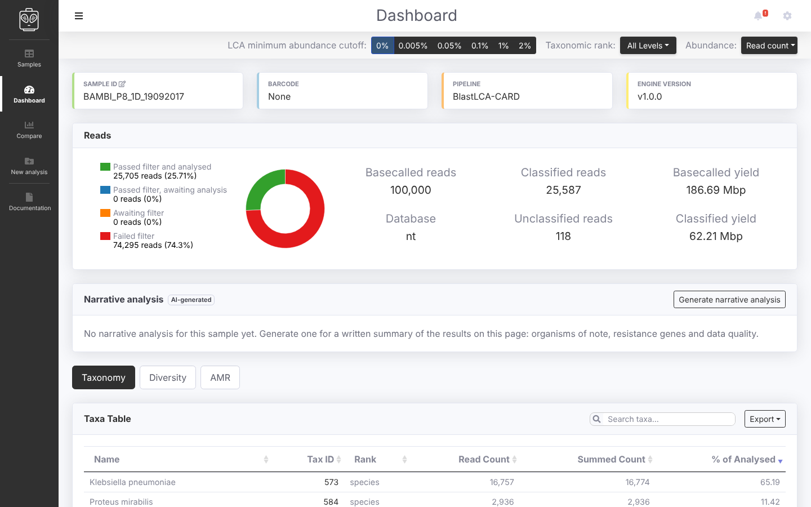
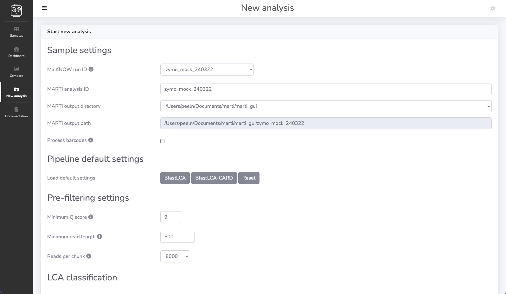
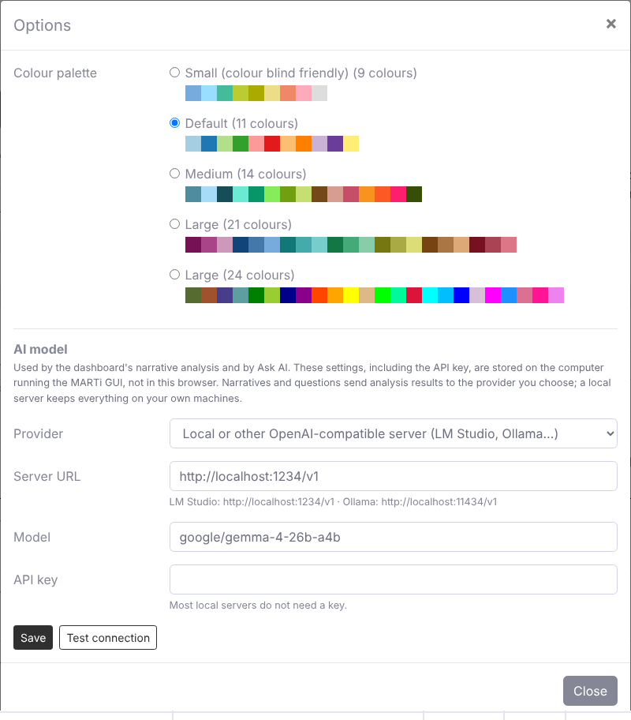

.. _gui:

The MARTi GUI
=============

The MARTi GUI is a browser-based interface for viewing and interacting with analyses. The GUI consists of four pages:

#. **Samples** - for selecting and loading analysed samples into the **Dashboard** and **Compare** pages.
#. **Dashboard** - for viewing analysis results of a single sample.
#. **Compare** - for comparing the results from multiple samples.
#. **New analysis** - for configuring and initiating local **MARTi Engine** analyses.

Launching the GUI
-----------------

The MARTi GUI can be launched with minimal configuration or with customised options, depending on your needs.

To quickly get started, you can run the GUI by providing a path to the MARTi output directories you want to monitor:

``marti_gui --marti /path/to/marti_output``

Once the server is running, open a browser and navigate to ``http://localhost:3000`` to access the GUI. The default port is 3000, but you can specify a different port using the ``--port`` option.

If you want to initiate analyses from the New Analysis page you will also need to provide paths to the NCBI taxonomy files and your read data or MinKNOW run directory:

``marti_gui --marti /path/to/marti_output --taxonomy /path/to/taxonomy --minknow /path/to/minknow/data``

Alternatively, you can store all these paths in a ``marti_engine_options.txt`` file and simply launch the GUI with:

``marti_gui``

**Usage:**

``marti_gui [options]``

**Options:**

* ``--taxonomy <path>``      Path to the NCBI taxonomy directory (e.g., ``/path/to/taxdmp``).
* ``--minknow <path>``       Path to the MinKNOW run directory or another directory containing nanopore data.
* ``--marti <paths>``        Semicolon-separated list of MARTi sample directories for the GUI to monitor.
* ``--port, -p <number>``    Port number for the server (default: 3000).
* ``--https <true|false>``   Enable or disable HTTPS (default: false).
* ``--key <path>``           Path to the SSL key file (required if HTTPS is enabled).
* ``--cert <path>``          Path to the SSL certificate file (required if HTTPS is enabled).
* ``--options <path>``       Path to a custom ``marti_engine_options.txt`` file (overrides default locations).
* ``--llm-python <path>``    Python used for narrative analysis (default: ``python3``). See :ref:`narrative-analysis`.
* ``--llm-tools <path>``     Folder containing the ``marti_llm`` package, if it is not installed in that Python.
* ``-r, --restricted``       Restricted mode: hides and refuses actions that change data or settings.
* ``--restricted-chat``      In restricted mode, still offer the AI chat (off by default).
* ``--help, -h``             Display this help message.

**Examples:**

Run the GUI while monitoring multiple output directories and specifying taxonomy and data paths:

``marti_gui --taxonomy /path/to/taxonomy --minknow /path/to/minknow/data --marti /path/to/output1;/path/to/output2``

Display the help message:

``marti_gui --help``

The Samples page
----------------

.. image:: images/GuiSamples.png
  :width: 800
  :alt: MARTi GUI samples page
  :align: center

The Samples page allows users to select and load available samples into the Dashboard and Compare analysis modes. A sample can be loaded into the Dashboard mode by clicking on its sample ID or the dashboard icon next to it. To compare samples, select them with the checkboxes in the first column of the table and then navigate to the Compare page.

The Dashboard page
------------------

The Dashboard page is for viewing analysis results of an individual MARTi sample. This could be a single nanopore sequencing run or an individual barcoded sample within a run. The sample can be one that was previously analysed by the **MARTi Engine**, or one that is currently being analysed. In the latter event, the information on the page will update in real time when new analysis information is made available by the Engine.

The Dashboard content is flexible and dependent on the available analyses for the selected sample. When all available analyses are run for a sample, the page can feature up to 8 cards (content containers):

#. Sample card – Displays information about the selected sample such as its ID, the analysis pipeline used, analysis status, and total number of basecalled reads.
#. Taxa table card – A table of taxa with hits at the selected taxonomic rank and lowest common ancestor cut off value.
#. Donut card – Interactive donut plot of classified reads at selected filter levels.
#. Tree card – Customisable tree plot representing all of the analysed reads.
#. Treemap card – An interactive treemap plot.
#. Taxa accumulation card – Line chart showing taxa discovered over time, or reads analysed.
#. AMR Table card – A table of antimicrobial-resistance (AMR) genes found in the sample.
#. Walkout Analysis card – Donut plot showing results from AMR gene walkout analysis.

The Compare page
----------------

.. image:: images/GuiCompare.png
  :width: 800
  :alt: MARTi GUI compare page
  :align: center

The Compare page enables multiple samples to be explored together, including samples being analysed in real time.

This page features four cards:

#. Samples card – Allows the user to sort the selected comparison samples by ID, sequencing date, yield, reads analysed, and by manually dragging them.
#. Stacked bar card – A stacked bar chart for viewing the taxonomic composition of the selected samples side-by-side.
#. Multi-donut card – A multi-donut plot for comparing the composition of assigned reads between samples.
#. Taxa accumulation card – A multi-line chart representing taxa discovery rates of each sample over the course of analysis, with the x-axis showing either reads sampled or time analysed.

.. _startinganalysis:

New analysis page
-----------------

The new analysis page allows users to generate a configuration file and start a local **MARTi Engine** analysis from the **MARTi GUI**.

The MARTi Engine requires a configuration (or ‘config’) file to start a new analysis of a whole run or selected barcoded samples. The config file provides the details for the analysis to be performed by the MARTi Engine (see :ref:`here for config file format information<configfiles>`). When running MARTi in an HPC configuration, a config file with default options can be :ref:`generated via the command line<cmdline>` and then edited with a text editor if required. In local configuration, you can use the command line method or the new analysis page of the MARTi GUI to generate a config file and start analysis.

The new analysis page is comprised of several cards that together house all the input fields and buttons required to generate a config file and start a new analysis. Two of the fields rely on information provided by the user in the marti_engine_options.txt file:

* Input data directory – this dropdown is automatically populated with samples available for MARTi analysis found within the MinKNOW run directory specified by the user.
* MARTi output directory – a dropdown of paths being monitored by the GUI’s server for MARTi output. Users specify this path, or a semicolon-separated list of paths, as MARTiSampleDirectory in the engine options file. The path selected in the dropdown will be used as the output location for the new analysis.

An example of how to start a new analysis from the new analysis page can be found :ref:`here<example>`.

Options
-------

The general options menu for the GUI can be accessed by clicking the cog icon in the top right-hand corner of the page. Alternative colour palettes for the GUI can be found in this menu.

The Dashboard and Compare pages have additional page-specific options bars fixed to the bottom of the header bar. On the Dashboard page, this houses three buttons:

1.	the *Assignments* button - for downloading MARTi’s taxonomic assignments in CSV format for downstream analysis.
2.	*LCA minimum abundance cut-off* selector – for displaying the sample’s taxonomic assignment data at one of four LCA minimum abundance cut-off values (0, 0.1, 1, or 2%).
3.	*Taxonomic rank* dropdown - allows users to view the plots at different taxonomic levels.

.. image:: images/GuiOptionsPlot.png
  :width: 800
  :alt: MARTi GUI plot options
  :align: center

Many of the plots also have plot-specific options that can be accessed via the three vertical dots menu icon in the top right-hand corner of the plot’s card.

.. _narrative-analysis:

Narrative analysis (AI)
-----------------------

The Dashboard has a *Narrative analysis* card: a short written summary of the sample's results (organisms of note,
antimicrobial resistance, data quality), written by an AI model. Narratives are only ever generated when someone
clicks *Generate narrative analysis*; nothing is sent to a model automatically.

How it works:

* The GUI runs ``python -m marti_llm.narrate``, which computes a fixed set of analyses from the sample's MARTi output
  (top taxa, screens against curated organism lists, priority resistance genes, diversity, sequencing saturation),
  sends those results to the model in one request, and checks every organism, resistance gene and number in the answer
  against them. Anything that does not match is shown on the card under *Automatic checks*.
* The narrative is saved as ``narrative.json`` in the sample's folder, next to ``sample.json``, so it moves with the
  sample's data. The GUI needs write access to that folder. Every user viewing the sample sees the same narrative.
* The sample's keywords (the ``Keywords`` line of the config file's ``Metadata`` block) choose what the narrative
  emphasises: for example *food*, *factory* or *drain* select the food manufacturing profile; *stool*, *patient* or
  *blood* the clinical profile; *air*, *bioaerosol* or *pollen* the outdoor air profile (not with *indoor*); *river*,
  *soil* or *wastewater* the environmental profile.
* If more reads have been analysed since the narrative was written, the card says so.

Setting up a model: open *Options* (the cog icon) and fill in *AI narrative analysis*. Choose Anthropic, OpenAI, or a
local or other OpenAI-compatible server (for example LM Studio at ``http://localhost:1234/v1`` or Ollama at
``http://localhost:11434/v1``), the model name, and an API key if the provider needs one. *Test connection* checks the
details without generating anything. The settings are stored on the computer running the GUI, in
``~/.marti/llm_settings.json`` (readable only by that account); the API key is never sent back to a browser. A key in
the ``MARTI_LLM_API_KEY`` environment variable takes precedence. With a cloud provider, each narrative sends a summary
of the sample's results to that provider; a local server keeps everything on your own machines. The engine itself
never contacts a model, so it can run without internet access.

Requirements: Python 3.10 or later with the ``marti_llm`` package, ``numpy`` and ``httpx`` (the ``mcp`` package is
only needed for marti-llm's MCP server, not for narratives). If ``marti_llm`` is not installed, point the GUI at its folder with ``--llm-tools`` or ``LLMToolsDir``.
The following ``marti_engine_options.txt`` entries are read by the GUI:

* ``LLMPython`` – the Python to run (default ``python3``)
* ``LLMToolsDir`` – folder containing the ``marti_llm`` package
* ``LLMSettingsFile`` – where the settings are stored (default ``~/.marti/llm_settings.json``)
* ``LLMTimeoutMinutes`` – how long one narrative or chat answer may take before it is stopped (default 10)
* ``LLMChatInRestrictedMode`` – ``true`` to offer the AI chat in restricted mode (default ``false``)

Narratives can also be written by Claude in the Claude app (or another MCP client) through marti-llm's MCP server,
using that app's own access rather than an API key: ask it to write the narrative analysis for a sample. It saves
``narrative.json`` with the same checks, and the card shows it within a few seconds.

In restricted mode (``-r``), existing narratives are shown, but there is no *Generate* button and no AI settings in
*Options*, and the server refuses requests to generate narratives or change the settings.

AI chat
-------

The Samples page, the Compare page and the Dashboard have an *Ask AI* button (bottom right) that opens a floating chat panel. Ask a
question about the samples on the page, for example "Do the groups differ in diversity?" or "Which organisms of
concern are present, and in which samples?". The model answers using the same analyses as marti-llm's MCP server
(diversity, group comparisons, pathogen and resistance-gene screens, co-occurrence and so on), run on the GUI server,
and it can only see the samples open on the page. On the Compare page it is told the groups you have assigned, and the
rank and minimum abundance you are viewing.

Answers contain links to the plots and tables they are based on: clicking one opens the right tab, scrolls to the
card and highlights it, while the panel stays open. A link to a sample opens its Dashboard. The model can only link to
a fixed list of places in the GUI; anything else is shown as plain text.

The chat uses the model chosen in *Options* (see above), and needs one that can call tools: Anthropic and OpenAI
models can, and so can many local models served by LM Studio or Ollama, though local models may be slow because each
answer can take several analysis steps. With a cloud provider, the question and the analysis results it needs are
sent to that provider.

Conversations are kept only in your browser (local storage), one per page and set of samples: reopening the same
comparison or sample brings the conversation back, and other users of the same GUI do not see it. The GUI server does
not store them. Use the download button to keep a conversation as a Markdown file, and the bin to clear it.

On the Samples page, *Ask AI* finds and selects samples. Ask for example "Select the samples collected in summer
2025", "Also select samples within 5 miles of Norwich", "Which samples contain Streptomyces?" or "List the samples
with E. coli". A search tool does the matching on the GUI server; the model only turns the request into a search
and says how it read it (for example, summer 2025 as 1 June to 31 August 2025). "Select" ticks the matching rows in
the table, replacing the selection unless you say "also" or "deselect"; the answer has *Undo* and *Compare* buttons.
"List" or "which" questions answer with links to each sample and leave the selection alone. Organism searches use the
lowest non-zero minimum abundance each sample has, so a single read counts, unless you ask for a threshold (for
example "at least 1% of classified reads"). Distances use the coordinates in each sample's ``metadata.json``
(``location``, as for the sample map, e.g. ``52.63, 1.29``); for samples without coordinates the model may estimate
a position from the place name, and then says which samples were placed by estimate.

On any page you can also ask Ask AI to open a view, for example "Open the treemap for Brancaster1_24-Jul" or
"Show me the PCoA". It opens that sample's Dashboard if needed and scrolls to the plot. Sample names can be given in
full, as run/name, or by a part that matches only one sample; if a name matches several, the model asks which.

In restricted mode the chat is off unless the GUI is started with ``--restricted-chat`` (or
``LLMChatInRestrictedMode:true``). Even then, users cannot change the AI settings.

Taxonomic ranks
---------------

To make it easier for users to filter organisms by their taxonomic ranks within the MARTi GUI, the NCBI taxonomic ranks have been simplified into 10 categories. The following table shows how the NCBI ranks are mapped to MARTi's simplified ranks.

+------------+----------+-------------------------------------------------------------------------------------------------------------------+
| MARTi rank | Rank no. | NCBI ranks                                                                                                        |
+============+==========+===================================================================================================================+
| No rank    | 0        | clade, no rank                                                                                                    |
+------------+----------+-------------------------------------------------------------------------------------------------------------------+
| Domain     | 1        | superkingdom                                                                                                      |
+------------+----------+-------------------------------------------------------------------------------------------------------------------+
| kingdom    | 2        | kingdom, subkingdom, superphylum                                                                                  |
+------------+----------+-------------------------------------------------------------------------------------------------------------------+
| Phylum     | 3        | phylum, subphylum, superclass                                                                                     |
+------------+----------+-------------------------------------------------------------------------------------------------------------------+
| Class      | 4        | class, cohort, infraclass, subclass, subcohort, superorder                                                        |
+------------+----------+-------------------------------------------------------------------------------------------------------------------+
| Order      | 5        | order, infraorder, parvorder, suborder, superfamily                                                               |
+------------+----------+-------------------------------------------------------------------------------------------------------------------+
| Family     | 6        | family, subfamily, subtribe, tribe                                                                                |
+------------+----------+-------------------------------------------------------------------------------------------------------------------+
| Genus      | 7        | genus, section, series, species group, species subgroup, subgenus, subsection                                     |
+------------+----------+-------------------------------------------------------------------------------------------------------------------+
| Species    | 8        | species, genotype, isolate                                                                                        |
+------------+----------+-------------------------------------------------------------------------------------------------------------------+
| Subspecies | 9        | subspecies, biotype, forma, forma specialis, morph, pathogroup, serogroup, serotype, strain, subvariety, varietas |
+------------+----------+-------------------------------------------------------------------------------------------------------------------+

Projects
--------

Projects in MARTi GUI allow users to group MARTi results for easier management and navigation. Once projects are set up, they can be accessed directly via the GUI using a URL like ``http://localhost:3000/project/airseq``.

To set up projects, create a ``projects.json`` file and place it in one of the MARTi output directories. You can specify entire directories, specific runs, or individual samples within a barcoded run. These directories must also be listed in the ``marti_engine_options.txt`` file as a ``MARTiSampleDirectory`` or specified in the ``marti_gui`` command like so:

``marti_gui --marti /path/to/marti_output/marc;/path/to/marti_output/airseq``

Here is an example of a ``projects.json`` file:

::

    {
        "defaultProject": "bambi",
        "bambi": {
            "directories": [],
            "runs": [
                "BAMBI_P103M_400ng_RAD4_20122017",
                "BAMBI_P106I_LSQK108_02022018",
                "BAMBI_P116I_SQK108_02022018",
                "BAMBI_P205G_1D_12012018",
                "BAMBI_P8_1D_19092017"
            ],
            "samples": []
        },
        "marc": {
            "directories": ["/path/to/marti_output/marc"],
            "runs": [],
            "samples": []
        },
        "airseq": {
            "directories": ["/path/to/marti_output/airseq"],
            "samples": ["NorfolkSeq_test_sample"]
        }
    }

In this example, the ``bambi`` project groups specific MARTi runs, ``marc`` uses a directory path, and ``airseq`` includes both a directory and a specific sample.
