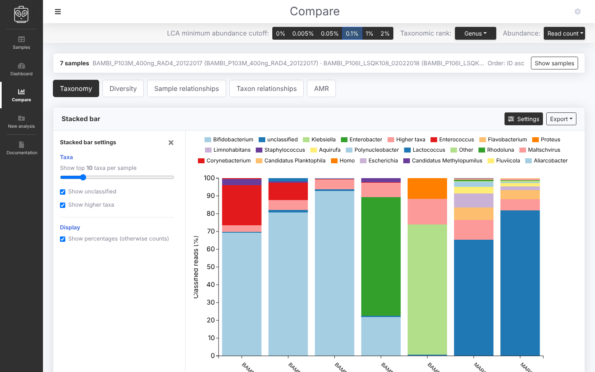

.. _gui:

The MARTi GUI
=============

The MARTi GUI is a browser-based interface for viewing and interacting with analyses. It is a small web server
(``marti_gui``) that watches one or more MARTi output directories and shows their results to any browser that can
reach it. Results update in real time while the MARTi Engine is still analysing a run.

The GUI has four pages, chosen from the bar on the left:

#. :ref:`Samples <guisamples>` - for finding, selecting and exporting analysed samples, and loading them into the
   **Dashboard** and **Compare** pages.
#. :ref:`Dashboard <guidashboard>` - for viewing the analysis results of a single sample.
#. :ref:`Compare <guicompare>` - for comparing the results of several samples, including diversity, sample
   relationships, taxon relationships and antimicrobial resistance.
#. :ref:`New analysis <startinganalysis>` - for configuring and starting local **MARTi Engine** analyses.

Optional :ref:`AI features <ai>` add a written narrative analysis to the Dashboard and an *Ask AI* chat panel to the
Samples, Compare and Dashboard pages.

.. _launchinggui:

Launching the GUI
-----------------

The MARTi GUI can be launched with minimal configuration or with customised options, depending on your needs.

To quickly get started, you can run the GUI by providing a path to the MARTi output directories you want to monitor:

``marti_gui --marti /path/to/marti_output``

Once the server is running, open a browser and navigate to ``http://localhost:3000`` to access the GUI. The default port is 3000, but you can specify a different port using the ``--port`` option.

If you want to initiate analyses from the New Analysis page you will also need to provide paths to the NCBI taxonomy files and your read data or MinKNOW run directory:

``marti_gui --marti /path/to/marti_output --taxonomy /path/to/taxonomy --minknow /path/to/minknow/data``

Alternatively, you can store all these paths in a ``marti_engine_options.txt`` file (see :ref:`guioptionsfile`) and simply launch the GUI with:

``marti_gui``

**Usage:**

``marti_gui [options]``

**Options:**

* ``--taxonomy <path>``      Path to the NCBI taxonomy directory (e.g., ``/path/to/taxdmp``).
* ``--minknow <path>``       Path to the MinKNOW run directory or another directory containing nanopore data.
* ``--marti <paths>``        Semicolon-separated list of MARTi sample directories for the GUI to monitor.
* ``--port, -p <number>``    Port number for the server (default: 3000).
* ``--https <true|false>``   Enable or disable HTTPS (default: false).
* ``--key <path>``           Path to the SSL key file (required if HTTPS is enabled).
* ``--cert <path>``          Path to the SSL certificate file (required if HTTPS is enabled).
* ``--options <path>``       Path to a custom ``marti_engine_options.txt`` file (overrides default locations).
* ``--llm-python <path>``    Python used for the AI features (default: ``python3``). See :ref:`ai`.
* ``--llm-tools <path>``     Folder containing the ``marti_llm`` package (default: MARTi's own ``marti-llm`` folder).
* ``-r, --restricted``       :ref:`Restricted mode <restrictedmode>`: hides and refuses actions that change data or settings.
* ``--restricted-chat``      In restricted mode, still offer the AI chat (off by default).
* ``--help, -h``             Display this help message.

**Examples:**

Run the GUI while monitoring multiple output directories and specifying taxonomy and data paths:

``marti_gui --taxonomy /path/to/taxonomy --minknow /path/to/minknow/data --marti "/path/to/output1;/path/to/output2"``

The quotes stop the shell treating ``;`` as the end of the command.

Display the help message:

``marti_gui --help``

.. _guioptionsfile:

GUI settings in marti_engine_options.txt
----------------------------------------

The GUI reads the same ``marti_engine_options.txt`` file as the Engine (from the current directory, then your home
directory, or the file given with ``--options``). Command-line options take precedence. The entries the GUI uses are:

* ``MARTiSampleDirectory`` - one or more MARTi output directories to monitor, separated by ``;`` (same as ``--marti``).
* ``MinKNOWRunDirectory`` - where the New analysis page looks for read data (same as ``--minknow``).
* ``TaxonomyDir`` - the NCBI taxonomy directory, for new analyses (same as ``--taxonomy``).
* ``Port`` - the port to listen on (default 3000).
* ``https`` - ``true`` to serve over HTTPS, with ``Key`` and ``Certificate`` giving the paths to the key and certificate files.
* ``MaxSimultaneousAnalyses`` - how many analyses the New analysis page may run at once (default 10).
* ``LLMPython``, ``LLMToolsDir``, ``LLMSettingsFile``, ``LLMTimeoutMinutes`` and ``LLMChatInRestrictedMode`` - settings
  for the :ref:`AI features <aisetup>`.

Each entry is one line of the form ``Name:value``.

.. _restrictedmode:

Restricted mode
---------------

Start the GUI with ``-r`` (or ``--restricted``) when it is shared with people who should be able to look at results
but not change anything, for example on a server that several groups use. In restricted mode:

* Samples cannot be renamed.
* The New analysis page is not available, and new analyses cannot be started.
* The AI settings are hidden from *Options*, and narratives cannot be generated or regenerated (existing ones are still
  shown).
* The *Ask AI* chat is off, unless the GUI is also started with ``--restricted-chat`` (or
  ``LLMChatInRestrictedMode:true`` in ``marti_engine_options.txt``). The chat never changes data on disk: it can
  select samples and open views, which only affect that user's own browser session.

The server itself refuses these requests, so they cannot be made by getting round the hidden buttons.

Things that only affect a user's own browser are unaffected: plot settings, the colour palette, and the sample order,
display names and groups on the Compare page.

Links to samples and projects
-----------------------------

The address bar follows what you are looking at, so you can bookmark or share it:

* ``http://<server>:3000/sample/<uuid>`` opens a sample's Dashboard. This is the address shown while a Dashboard is
  open; the ``uuid`` comes from the sample's ``sample.json``.
* ``http://<server>:3000/project/<project>`` opens the GUI showing only that :ref:`project's <projects>` samples.

.. _guioptions:

Options
-------

.. image:: images/GuiOptionsGeneral.png
  :width: 600
  :alt: MARTi GUI options
  :align: center

The *Options* dialog is opened with the cog icon in the top right-hand corner of every page. It contains:

* *Colour palette* - the colours used for taxa in the plots, including a colour-blind-friendly palette.
* *AI model* - the model used by the :ref:`AI features <aisetup>`. This section is hidden in
  restricted mode.

Page options bar
----------------

The Dashboard and Compare pages have an options bar fixed below the page title. Its settings apply to every plot on the
page:

* *LCA minimum abundance cutoff* - show the results at one of the minimum abundance (min support) thresholds the Engine
  writes: 0%, 0.005%, 0.05%, 0.1% (the default), 1% or 2%. Taxa below the threshold have their reads moved up to a
  higher taxon (see :ref:`faqs`). Low thresholds show rare taxa; higher thresholds give simpler plots. Output from
  older versions of the Engine may not have every threshold.
* *Taxonomic rank* - show the plots at one :ref:`rank <taxonomicranks>` (domain to species), or at all levels.
* *Abundance* - measure abundance as a *Read count* or as *bp yield* (bases of classified sequence).

Plot settings and export
------------------------

Most plots have *Settings* and *Export* buttons in the top right-hand corner of their card:

* *Settings* opens a panel of options for that plot, such as how many taxa to show, whether to include unclassified
  reads and *higher taxa* (reads assigned above the selected rank), and colour scales.
* *Export* downloads the plot as SVG (for editing or publication), PNG or JPG, and, for most plots, the data behind
  it as CSV.

.. _taxonomicranks:

Taxonomic ranks
---------------

To make it easier for users to filter organisms by their taxonomic ranks within the MARTi GUI, the NCBI taxonomic ranks have been simplified into 10 categories. The following table shows how the NCBI ranks are mapped to MARTi's simplified ranks.

+------------+----------+-------------------------------------------------------------------------------------------------------------------+
| MARTi rank | Rank no. | NCBI ranks                                                                                                        |
+============+==========+===================================================================================================================+
| No rank    | 0        | clade, no rank, cellular root                                                                                     |
+------------+----------+-------------------------------------------------------------------------------------------------------------------+
| Domain     | 1        | domain, superkingdom, acellular root                                                                              |
+------------+----------+-------------------------------------------------------------------------------------------------------------------+
| Kingdom    | 2        | kingdom, subkingdom, superphylum, realm                                                                           |
+------------+----------+-------------------------------------------------------------------------------------------------------------------+
| Phylum     | 3        | phylum, subphylum, superclass                                                                                     |
+------------+----------+-------------------------------------------------------------------------------------------------------------------+
| Class      | 4        | class, cohort, infraclass, subclass, subcohort, superorder                                                        |
+------------+----------+-------------------------------------------------------------------------------------------------------------------+
| Order      | 5        | order, infraorder, parvorder, suborder, superfamily                                                               |
+------------+----------+-------------------------------------------------------------------------------------------------------------------+
| Family     | 6        | family, subfamily, subtribe, tribe                                                                                |
+------------+----------+-------------------------------------------------------------------------------------------------------------------+
| Genus      | 7        | genus, section, series, species group, species subgroup, subgenus, subsection                                     |
+------------+----------+-------------------------------------------------------------------------------------------------------------------+
| Species    | 8        | species, genotype, isolate                                                                                        |
+------------+----------+-------------------------------------------------------------------------------------------------------------------+
| Subspecies | 9        | subspecies, biotype, forma, forma specialis, morph, pathogroup, serogroup, serotype, strain, subvariety, varietas |
+------------+----------+-------------------------------------------------------------------------------------------------------------------+

.. _startinganalysis:

New analysis page
-----------------

.. image:: images/GuiNew.png
  :width: 800
  :alt: MARTi GUI new analysis page
  :align: center

The new analysis page allows users to generate a configuration file and start a local **MARTi Engine** analysis from the **MARTi GUI**.

The MARTi Engine requires a configuration (or ‘config’) file to start a new analysis of a whole run or selected barcoded samples. The config file provides the details for the analysis to be performed by the MARTi Engine (see :ref:`here for config file format information<configfiles>`). When running MARTi in an HPC configuration, a config file with default options can be :ref:`generated via the command line<cmdline>` and then edited with a text editor if required. In local configuration, you can use the command line method or the new analysis page of the MARTi GUI to generate a config file and start analysis.

The new analysis page is comprised of several cards that together house all the input fields and buttons required to generate a config file and start a new analysis. Two of the fields rely on information provided by the user in the marti_engine_options.txt file:

* Input data directory – this dropdown is automatically populated with samples available for MARTi analysis found within the MinKNOW run directory specified by the user.
* MARTi output directory – a dropdown of paths being monitored by the GUI’s server for MARTi output. Users specify this path, or a semicolon-separated list of paths, as MARTiSampleDirectory in the engine options file. The path selected in the dropdown will be used as the output location for the new analysis.

An example of how to start a new analysis from the new analysis page can be found :ref:`here<example>`.
