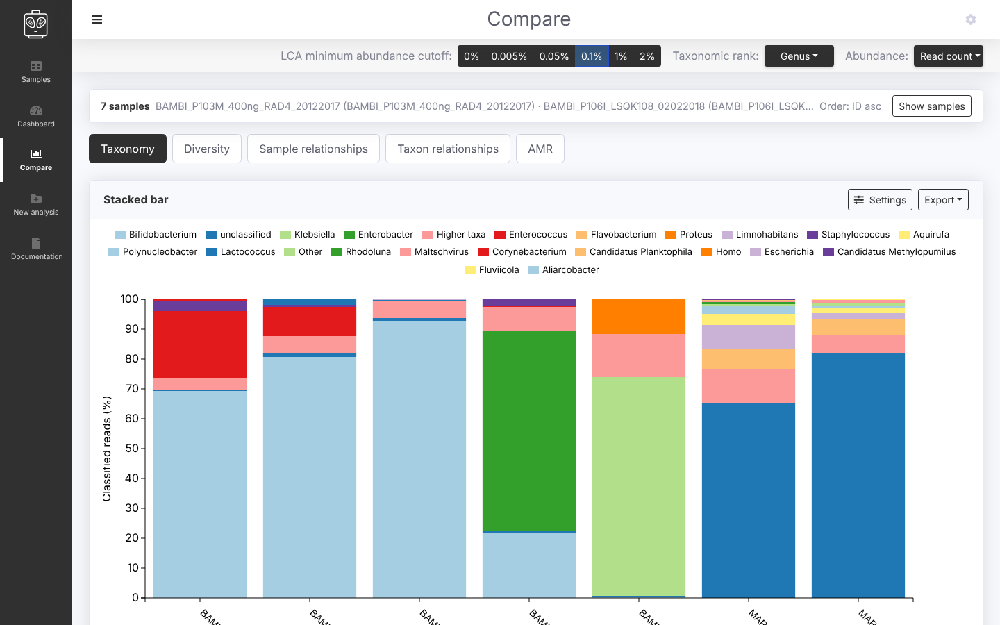
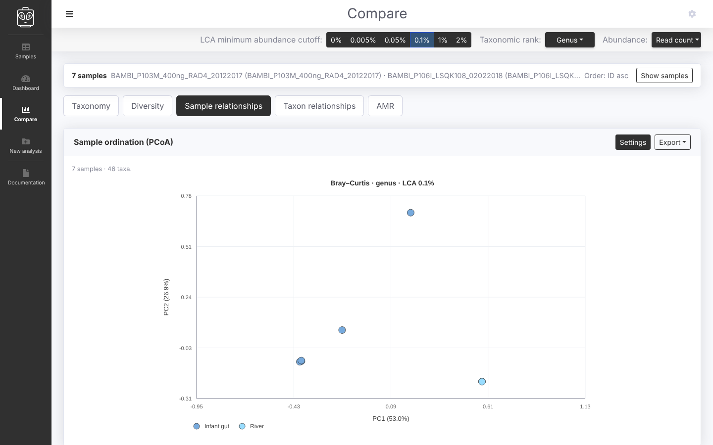

.. _guicompare:

The Compare page
================

The Compare page enables multiple samples to be explored together, including samples being analysed in real time.
Select samples on the :ref:`Samples page <guisamples>` and click *Compare samples* to open them here.

As on the Dashboard, the plots follow the LCA minimum abundance cutoff, taxonomic rank and abundance measure chosen in
the :ref:`options bar <guioptions>` below the page title.

.. _comparesamplescard:

Samples card and groups
-----------------------

The *Samples* card at the top of the page lists the samples being compared; click *Show samples* to open its table. It
sets three things that every plot on the page uses:

* **Order** - sort the samples by ID, run, group, barcode, yield or reads analysed, or choose *Manual* and drag rows
  into the order you want. Plots show samples in this order.
* **Names** - type a name in the *Sample* column to label a sample on this page with a shorter or clearer name. This
  name is kept only in your browser; the undo button restores the shared name. To rename a sample for everyone, see
  :ref:`renaming`.
* **Groups** - type the same group name for samples that belong together, for example sites, treatments or time
  points. *Set groups from metadata* fills in the groups from each sample's location or sampling date. Groups can
  colour points and lines, and several plots can show results per group instead of per sample.

A :ref:`project <projects>` can supply default groups with ``sampleGroups`` in ``projects.json``. Changes you make on
this page override them and are saved in your browser for that project; *Reset all groups to project defaults*
removes your changes.

The plots are arranged in five tabs.

Taxonomy tab
------------

* *Stacked bar* - the taxonomic composition of each sample side by side. Options set the number of top taxa per sample,
  and whether to show unclassified reads, higher taxa and percentages or counts.
* *Taxa heatmap* - abundance of taxa (rows) across samples (columns). Choose which taxa to show:

  * *Top taxa per sample* - the top *N* taxa of each sample, up to a maximum number of rows.
  * *Custom taxon IDs* - your own list of NCBI taxon IDs (type IDs, or add taxa by name). Rows keep the order you give,
    include each taxon's descendants, and do not depend on the rank selector.
  * A project's *presets* - named taxon lists defined with ``heatmapTaxaPresets`` in ``projects.json`` (see
    :ref:`projects`), for example a list of pathogens or indicator organisms.

  Percentages can be of all reads (taxon 1) or of another taxon such as Bacteria (2) or Fungi (4751), and values below
  a minimum abundance can be shown as zero. Colour schemes include *Traffic lights* with your own thresholds; cells can
  be shown as coloured squares or as bubbles, with or without their values.
* *Taxon trends* - how chosen taxa change across the samples: one panel per taxon, with samples (in Compare order) or
  sampling dates along the x axis. By default it shows broad groups (Bacteria, Archaea, Fungi, plants, animals and
  viruses); choose *Custom taxon IDs* for your own taxa. Lines can be drawn for all samples together, for each group,
  or for each location.
* *Tree* - a combined taxonomic tree of all the samples, in which each node has a small bar chart of the taxon's
  abundance in each sample. Click a node to expand or collapse it.
* *Donut* - one donut plot per sample, for comparing the composition of assigned reads.

Diversity tab
-------------

* *Taxa accumulation* - each sample's taxa accumulation curve, or how its Shannon diversity, Pielou evenness or inverse
  Simpson diversity developed during the run (see the :ref:`Dashboard Diversity tab <guidashboard>`). Lines can be
  coloured by sample or by group.
* *Diversity across samples* - one diversity measure for every sample, or the mean and range for each group. Measures
  are the number of taxa (S), Shannon diversity (H'), inverse Simpson diversity, Pielou evenness (J') and rarefied
  richness. *Rarefied richness* is the expected number of taxa at the same sequencing depth for every sample (the
  smallest number of included reads among the samples), which makes samples sequenced to different depths
  comparable. Samples can be shown in Samples card order or sorted by value.
* *Diversity metrics* - a table of these measures for every sample, which can be copied or exported as CSV.

See :ref:`diversity` for how the measures are calculated.

Sample relationships tab
------------------------

These plots show which samples have similar taxonomic profiles. Each offers two distance measures:

* *Bray–Curtis* - based on relative abundances; dominated by the most abundant taxa.
* *Aitchison* - the Euclidean distance between centred log-ratio (CLR) transformed counts, which treats the data as
  compositions and gives more weight to less abundant taxa. A small *pseudocount* is added to every count first, because
  the logarithm of zero is undefined.

*Taxon present in at least this many samples* removes rare taxa that occur in only one or a few samples.

* *Sample ordination (PCoA)* - principal coordinates analysis: samples that are close together have similar profiles.
  View it in 2D or 3D (drag to rotate, scroll to zoom), and colour points by run, site, group or one colour. Groups
  change the colours, not the positions.
* *Sample clustering (UPGMA)* - a dendrogram that joins the most similar samples first.
* *Sample distances* - the distance between every pair of samples as a heatmap; darker cells are more similar.

Coordinates and distances can be exported as CSV.

Taxon relationships tab
-----------------------

These plots look for taxa whose abundances rise and fall together across the samples. They need several samples, and
they are exploratory: associations between taxa in relative abundance data can arise because the proportions must add
up to 100%, so check interesting pairs in the underlying data.

* *Taxon correlations across samples* - a correlation matrix (Pearson or Spearman) of the most abundant taxa, using
  each taxon's share of the reads assigned at the selected rank. Taxa must be supported (have enough reads) in a
  minimum number of samples.
* *Strongest taxon correlations* - the most strongly positively and negatively correlated pairs among all taxa that
  pass the support filters, not just the most abundant. *Inspect* a pair to see a scatter plot of the two taxa in every
  sample, coloured by sampling date, location or run.
* *Taxon co-occurrence across samples* - a network linking taxa that are present in the same samples, measured by
  Jaccard overlap (the share of samples containing either taxon that contain both). Options set the reads needed for a
  taxon to count as present, how many samples it must be present in, and how many links to show.
* *Shared taxa (UpSet)* - which taxa are found in which combinations of samples, or of groups. Each bar counts the
  taxa present in exactly that combination; bars can be split into broad taxonomic groups. Presence thresholds can be
  set as reads or as a percentage of the sample.

AMR tab
-------

* *AMR heatmap* - antimicrobial resistance gene hits across samples, by gene, drug class or resistance mechanism, as
  counts or as a percentage of each sample's AMR hits. A gene can belong to more than one drug class or mechanism, so
  percentages by drug class can add up to more than 100% (see :ref:`faqs`).

Ask AI on the Compare page
--------------------------

With the :ref:`AI features <ai>` set up, the *Ask AI* button answers questions about the samples being compared, using
the groups set in the Samples card, with links to the plots its answers are based on. See :ref:`askai`.
