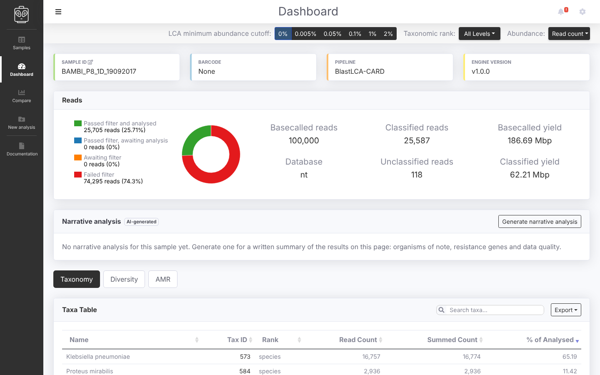

.. _guidashboard:

The Dashboard page
==================

The Dashboard page is for viewing analysis results of an individual MARTi sample. This could be a single nanopore sequencing run or an individual barcoded sample within a run. The sample can be one that was previously analysed by the **MARTi Engine**, or one that is currently being analysed. In the latter event, the information on the page will update in real time when new analysis information is made available by the Engine.

Open a sample's Dashboard with the dashboard icon next to its sample ID on the :ref:`Samples page <guisamples>`. The address bar then shows
a link to this sample's Dashboard (``/sample/<uuid>``) that you can bookmark or share.

The plots follow the LCA minimum abundance cutoff, taxonomic rank and abundance measure chosen in the
:ref:`options bar <guioptions>` below the page title. The bell icon in the header shows the Engine's alerts for the
sample, such as when its analysis started and finished.

Summary cards
-------------

* *Sample ID*, *Barcode*, *Pipeline* and *Engine version*. Click the edit icon next to the sample ID to rename the
  sample (see :ref:`renaming`).
* *Reads* - how many reads have passed the quality filter and been analysed, are waiting for analysis or filtering, or
  failed the filter; the numbers of basecalled, classified and unclassified reads; basecalled and classified yields;
  and the classification database used.
* *Narrative analysis* - a short AI-written summary of the sample's results, if one has been generated. See
  :ref:`narrative-analysis`.

Below these, the results are arranged in three tabs. Tabs whose results the sample does not have (for example AMR when
no CARD analysis was run) have nothing to show.

Taxonomy tab
------------

* *Taxa Table* - the taxa at the selected rank and cutoff, with their NCBI taxon ID, rank, read count (reads assigned
  to the taxon itself), summed count (including all its descendants) and percentage of analysed reads. *Export*
  saves the table as CSV.
* *Donut* - the composition of classified reads, showing the top *N* taxa, with options to show unclassified reads and
  higher taxa.
* *Tree* - the taxonomic tree, with node sizes scaled by read count (linear, square root or log scale). Choose curved
  or straight links, a tree or cluster layout, and how many leaves to show.
* *Treemap* - nested rectangles sized by abundance, coloured by a chosen rank (domain to genus). Options include square
  or rectangular shapes, the background colour, showing only one group of organisms (for example Bacteria,
  Eukaryota or Viruses), group labels and a minimum font size.
* *Sankey* - the flow of reads from the root through each rank to the leaf taxa, with options to choose which ranks are
  shown as columns and labelled.

Diversity tab
-------------

The *Sample diversity* card shows how the sample's diversity developed as reads were analysed, and its current
diversity at the selected rank and cutoff.

* *Measure* - plot taxa accumulation (the number of taxa found), Shannon diversity (H'), Pielou evenness (J') or inverse
  Simpson diversity (1/D). The diversity curves need results from MARTi Engine v1.0.0 or later, which records diversity
  after every chunk of reads.
* *Accumulation definition* - *Final taxa set* (the default) counts, at each point, how many of the taxa present at
  the end of the run had been seen so far, so the curve never goes down. *Per-chunk taxa count* counts the taxa present
  in the tree at each point; this can fall when the LCA cutoff moves reads to a higher taxon (see :ref:`faqs`).
* *X axis* - reads analysed, or elapsed time in minutes. *X-axis maximum* zooms in on the start of a run.

The *Diversity metrics* panel beside the plot gives the current number of taxa (S), Shannon diversity (H'), Pielou
evenness (J') and inverse Simpson diversity for the selected rank, and N, the number of reads (or bases, with *bp
yield*) in the taxa included. N can be less than the number of classified reads because only taxa at the selected
rank and above the cutoff are included. *Export* saves the current values or the plotted curves as CSV.

How these measures are calculated is described in :ref:`diversity`.

AMR tab
-------

When reads were searched against the CARD database, the AMR tab shows the antimicrobial resistance genes found.

* *AMR Table* - each resistance gene with its description, drug class, resistance mechanism, gene family, the putative
  host taxa of the reads it was found in, and putative plasmid hits. *Export* saves the table as CSV or copies it.
* *Putative Host Taxa Analysis* - the taxa that reads carrying resistance genes were assigned to, plotted by AMR gene,
  drug class or resistance mechanism. This comes from the Engine's *walkout* analysis, which needs reads to be
  classified with BLAST.
* *AMR hits* - the resistance gene hits grouped by gene, drug class or resistance mechanism.

The *Chunk* slider on these cards shows the results as they were after an earlier chunk of reads, so you can see when
each gene was first detected.

Ask AI on the Dashboard
-----------------------

With the :ref:`AI features <ai>` set up, the *Ask AI* button answers questions about this sample, with links to the
plots and tables the answer is based on. See :ref:`askai`.
