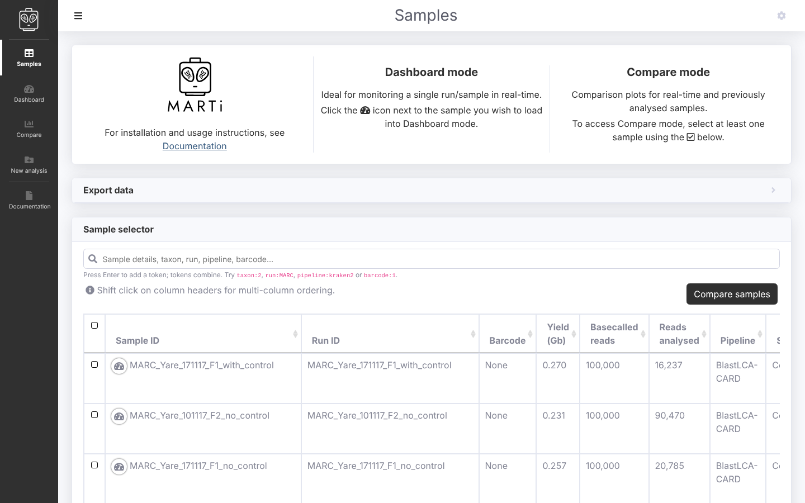

.. _guisamples:

The Samples page
================

The Samples page lists every sample in the MARTi output directories the GUI is monitoring (or, when a
:ref:`project <projects>` is open, the samples in that project). From here you can open a sample's Dashboard, choose
samples to compare, export results and see where samples were collected.

Sample selector
---------------

The *Sample selector* table has one row per sample, showing its sample ID, run ID, barcode, yield, numbers of
basecalled and analysed reads, the classification pipeline, analysis status and analysis date. Shift-click on column
headers to sort by more than one column.

* Click the dashboard icon next to a sample ID to open the sample in the :ref:`Dashboard <guidashboard>`.
* Tick the checkboxes in the first column to select samples, then click *Compare samples* (or *Compare* in the bar on
  the left) to open them in the :ref:`Compare <guicompare>` page. The checkbox in the header selects every sample shown.
* Click the *More info* icon at the end of a row for the sample's details: run, sequencing and analysis dates, read
  counts at each stage, the MARTi Engine version, status and pipeline. The *Sample Name* field in this dialog renames
  the sample (see :ref:`renaming`).

Searching and filtering
^^^^^^^^^^^^^^^^^^^^^^^

Type in the search box above the table to filter it. Press Enter to turn what you typed into a filter *token*; several
tokens can be combined, and a sample must match all of them. Suggestions appear as you type. As well as plain text,
which matches any column, you can use:

* ``taxon:`` followed by a taxon name or NCBI taxon ID, e.g. ``taxon:Listeria`` or ``taxon:2`` - samples in which any
  reads were assigned to that taxon or below it. This uses the sample's lowest LCA minimum abundance cutoff (normally
  0%), so a single read counts.
* ``run:``, ``pipeline:``, ``barcode:``, ``sample:`` and ``status:`` - match that column only, e.g. ``run:MARC``,
  ``pipeline:kraken2`` or ``barcode:1``.

Clear the filters with the × at the end of the search box.

Sample map
----------

If samples have coordinates in their metadata, the *Sample Map* card shows where they were collected. Click a marker
to see the sample's name, run, location name and coordinates (linked to Google Maps), with a checkbox to select it for
comparison. The map reads the coordinates (latitude and longitude, e.g. ``52.63, 1.29``) from the ``sampleLocation``
field that the Engine writes from the config file's ``Location``, or from a ``location`` field, and the site's name
from ``locationName``, in each sample's ``metadata.json`` (see :ref:`metadata`). The map tiles are downloaded from the internet, so the map needs an internet connection; the card is
hidden when no sample has coordinates.

.. _exportdata:

Export data
-----------

The *Export data* card (click its title to open it) downloads the taxonomic assignments of the selected samples as one
table, for analysis in other software. Select samples in the table first, then choose:

* *Taxonomic rank* and *LCA minimum abundance cutoff* - which results to export.
* *Ranks to include* - only the selected rank, or the selected rank and higher levels. Summed counts include
  descendants, so summed counts from rows at different ranks overlap.
* *Include unclassified* - add a row for unclassified reads.
* *Columns* - every row includes the sample ID, run ID and barcode. Add any of the taxon name, NCBI ID, rank and rank
  number; the direct read count (reads assigned exactly to the taxon), the summed read count (including its
  descendants), and the mean and mean maximum BLAST identity; and lineage columns with the IDs or names of each
  taxon's ancestors.
* *Field separator* - comma (CSV), tab (TSV), colon or semicolon.

Then click *Export selected samples*.

Ask AI on the Samples page
--------------------------

With the :ref:`AI features <ai>` set up, the *Ask AI* button finds and selects samples from a description, for
example "Select the samples collected in summer 2025" or "Which samples contain Streptomyces?". See
:ref:`askaisamples`.
